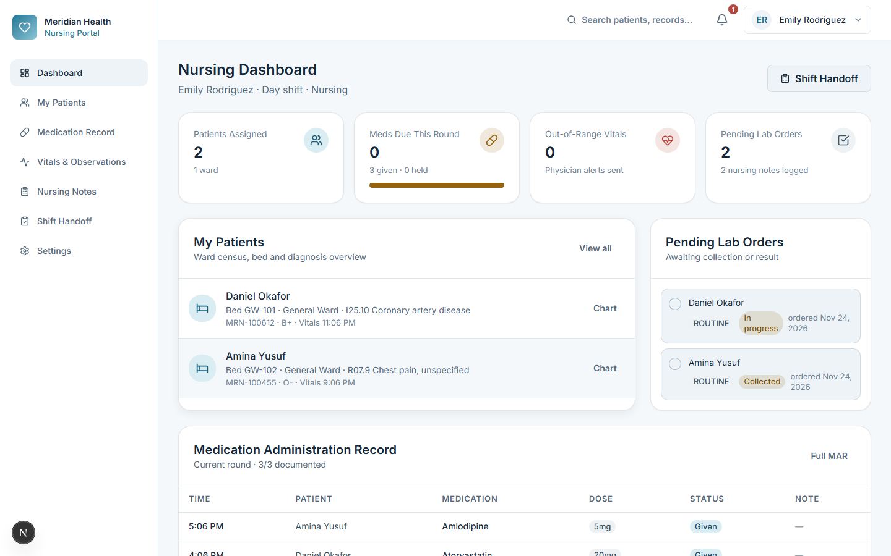
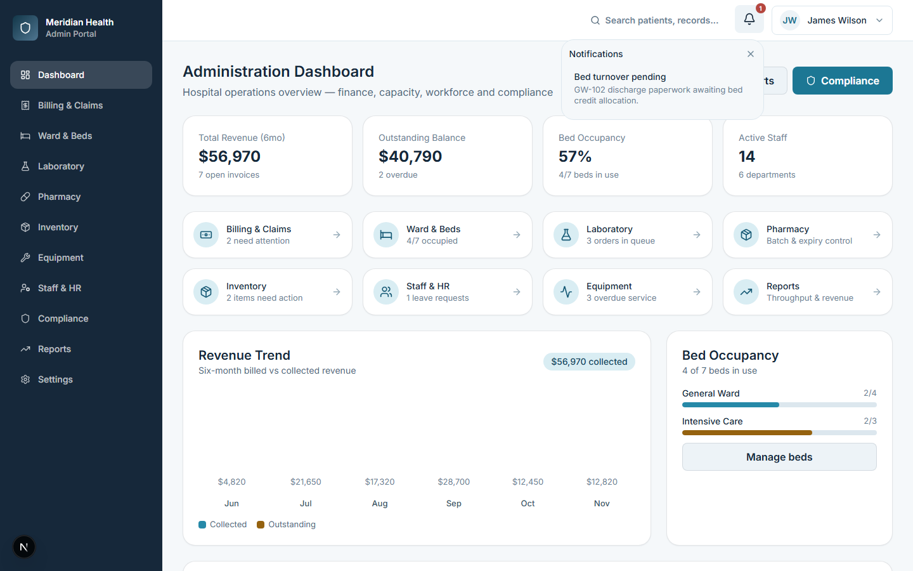
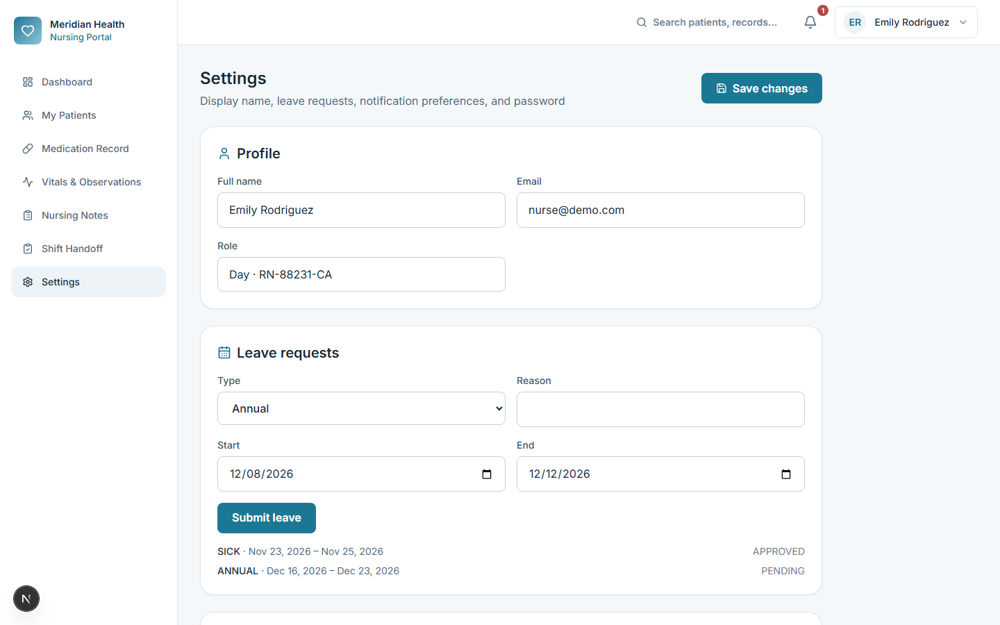

<div align="center">

# 🏥 Meridian Health

**A multi-role hospital portal — one app for patients, doctors, nurses and administrators.**


</div>

---

## ✨ Why Meridian?

Hospital software is usually a maze of separate tools: scheduling in one place, charting in another, billing somewhere else. Meridian brings the whole day into one portal with four role-specific views. A patient books appointments and reads results; a doctor manages a schedule and charts visits; a nurse runs the ward census and shift handoff; an admin looks after billing, pharmacy, inventory and reports.

It is a portfolio demonstration, not a clinical product. Every record comes from the seed script, access controls are modelled carefully, and the app is explicit about what it is *not* — which is the honest way to show hospital workflow without touching real patient data.

### 🧩 What's inside

| Role | Portal | Scope |
| --- | --- | --- |
| Patient | `/portal/patient` | Appointments, results, medications, records, billing, messages |
| Doctor | `/portal/doctor` | Schedule, panel, charting, prescriptions |
| Nurse | `/portal/nurse` | Ward census, medication administration, vitals, notes, shift handoff |
| Admin | `/portal/admin` | Billing, wards, lab, pharmacy, inventory, equipment, HR, reports |

- 🔐 **Route protection** in `hms-portal/src/proxy.ts`, with every API route checking the role again before reading or writing.
- 💸 **Transactions** for appointment booking and invoice payment, so the database runs as a replica set.
- 🎞️ **Motion** from Framer Motion for portal transitions.
- 🔁 **Re-runnable seed** that replaces clinical data for the four demo accounts and leaves other accounts alone.

> ⚠️ **Demo disclaimer:** every record is fictional and seeded. This is not a certified clinical system — do not put real patient information in it.

---

## 📸 Screenshots

Fictional demonstration data.

| Nursing census | Admin notifications |
| --- | --- |
|  |  |



---

## 🚀 Quick start

Requirements: Node.js 20+ and a MongoDB replica set (a single-node set or MongoDB Atlas works). Appointment booking and invoice payment use multi-document transactions, which a standalone `mongod` rejects.

```bash
cd hms-portal
npm install
```

Copy `.env.example` into `.env.local`:

```env
DATABASE_URL="mongodb://127.0.0.1:27017/hms?replicaSet=rs0&directConnection=true"
AUTH_SECRET="generate-with-openssl-rand-base64-32"
NEXT_PUBLIC_APP_URL="http://localhost:3000"
```

```bash
npm run db:push
npm run db:seed
npm run dev
```

Open http://localhost:3000. Demo password for every account: `demo123`.

| Email | Role |
| --- | --- |
| `patient@demo.com` | Patient |
| `doctor@demo.com` | Doctor |
| `nurse@demo.com` | Nurse |
| `admin@demo.com` | Admin |

---

## 🧱 Stack

| Concern | Choice |
| --- | --- |
| Framework | Next.js 16 (App Router) |
| Language | TypeScript |
| Styling | Tailwind CSS v4 |
| Database | MongoDB via Prisma 5 |
| Auth | Auth.js / NextAuth v5, credentials and JWT |
| Motion | Framer Motion |

---

## 🗺 Roadmap ideas

- 📅 Calendar views for schedules and appointments
- 📄 Printable referrals and prescriptions
- 🔔 In-app notifications for results and handoffs
- 🧪 Automated role-access regression tests

Design notes, the data model, deployment guidance and known gaps live in [hms-portal/README.md](hms-portal/README.md).

---

<div align="center">

Fictional data, real access-control modelling. Built with Next.js and Prisma.

</div>
